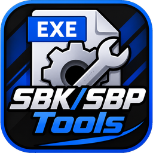

<p align="center">
  
</p>

<h1 align="center">Gow SBK Tools</h1>

<p align="center">
  Edit the <b>audio</b> (SBK / SBP sound banks) inside <b>God of War 1 &amp; 2 (PS2)</b> ISOs and <code>.WAD</code> files.<br>
  Windows · Wine · Winlator &nbsp;|&nbsp; by <b>Nicho</b>
</p>

<p align="center">
  <a href="#english">English</a> ·
  <a href="#bahasa-indonesia">Bahasa Indonesia</a> ·
  <a href="#português-brasil">Português (Brasil)</a>
</p>

---

## English

### What is it?
A PC tool that edits the **sound banks inside WAD files** of God of War 1 and 2. Open the game **ISO** (or a loose WAD / a folder of WADs), pick an SBK, play / export / replace any sound with your own WAV, and save straight back. The app has its own language selector: **Bahasa Indonesia, English, Português (Brasil)**.

### Features
- Open a **GoW 1 / GoW 2 ISO**: `PART1.PAK` / `PART2.PAK` → WAD list (read through `GODOFWAR.TOC`). Only WADs that hold sounds are shown; **VPK, VAG, PSS/PSW** and WADs without an SBK are hidden.
- Or open a single **WAD** / a **folder of WADs**.
- Built-in **SBK catalog** with search (385 SBKs); *Open this WAD* jumps to it in the opened ISO.
- **Play**, **Export WAV**, **Hear WAV** (before inserting), **Replace from WAV** — per sample.
- Both bank types: internal audio banks and VAG banks (real sample rate read for VAG).
- **SAVE** straight into the ISO at **every copy** of the WAD, after checking the WAD marker; the original bytes go to `NAME.iso.sbkbak` and **Restore ISO** brings them back. Loose WADs keep a `.bak`.
- When your WAV is longer than the slot: **Enlarge** (loose WADs only), **Lower rate** (VAG banks), or **Cut**.

### Coverage (from the WADs scanned by the author)
| Game | WADs scanned | SBKs with audio | In WADs |
|------|-------------:|----------------:|--------:|
| GoW 1 | 216 | 200 | 155 |
| GoW 2 | 293 | 185 | 185 |

### Download
- **Actions artifact:** *Actions* tab → latest run → artifact **SBK Tools**.
- **Releases:** push a tag like `v1.1` and the workflow publishes `SBK Tools.zip`.

The package holds the readme / information files in 3 languages, the SBK catalog and the folder **`SBK Tools`** (`SBK_Tools.exe` + DLLs).
> ⚠️ Keep the **whole** `SBK Tools` folder together; do not move the `.exe` alone.

### How to use
1. Run `SBK_Tools.exe` (the first launch asks for a language).
2. **Open ISO** → click `>` next to `PART1.PAK` / `PART2.PAK` → pick a WAD (or **Open WAD / Open WAD folder**).
3. Pick an SBK → **Edit audio** → choose a sample → **Replace from WAV**.
4. **SAVE**.

### Important notes
- **ISO writing:** a WAD inside an ISO must keep its size, so **Enlarge is not available there**; use a shorter WAV, **Cut** or **Lower rate**. Work on a **copy** of the ISO and close other programs that use it.
- **Sample rate:** VAG banks carry theirs; internal banks do not, so the tool guesses 22050 Hz — adjust it until *Play* sounds normal.
- **Tested:** all scanned WADs (replace/enlarge, automated); the ISO/TOC reader on simulated ISOs built from the real GoW 1 / GoW 2 `GODOFWAR.TOC` and real WADs; the author also tested loose-WAD results in-game. **Writing into a real game ISO has not been tested on a real device yet.**

### Out of scope
Standalone VPK/VAG/PSS/PSW files, streams outside the WADs, cutscenes, 3D models, textures (see *Texture Editor*), loose `PART*.PAK` files, and rebuilding ISOs.

### Run from source / build
```bash
python gow_wad_sbk_tool.py          # Python 3.8+, no extra libraries
```
Windows build: `build.bat`, or **GitHub Actions** (`.github/workflows/build.yml`) builds `SBK Tools.zip` (folder build, Python 3.10, works on Wine/Winlator).

### Reporting bugs
Errors go to `gow_tool_error.txt` (next to the exe) and the error window shows where. Send that text plus the names of the WAD and SBK you opened.

### Legal
No game files are included. Use it only with your own copy of the game. Fan project, not affiliated with Sony or Santa Monica Studio. *God of War* is a trademark of its owners. Provided as is, without warranty.

### Credits
Made by **Nicho**. Thanks to the **God of War Browser** project and **AssetForge**, which helped in understanding the file formats and the workflow.

---

## Bahasa Indonesia

### Apa ini?
Tool PC untuk mengedit **bank suara di dalam file WAD** God of War 1 dan 2. Buka **ISO** game (atau satu WAD / folder WAD), pilih SBK, putar / export / ganti suara apa pun dengan WAV milikmu, lalu simpan langsung. Aplikasinya punya pilihan bahasa sendiri: **Bahasa Indonesia, English, Português (Brasil)**.

### Fitur
- Buka **ISO GoW 1 / GoW 2**: `PART1.PAK` / `PART2.PAK` → daftar WAD (dibaca lewat `GODOFWAR.TOC`). Hanya WAD yang berisi suara yang tampil; **VPK, VAG, PSS/PSW** dan WAD tanpa SBK disembunyikan.
- Atau buka satu **WAD** / **folder WAD**.
- **Katalog SBK** bawaan dengan pencarian (385 SBK); *Buka WAD ini* langsung menuju WAD itu di ISO yang terbuka.
- **Putar**, **Export WAV**, **Dengar WAV** (sebelum dimasukkan), **Replace dari WAV** — per sampel.
- Dua jenis bank: bank audio internal dan bank VAG (sample rate asli dibaca untuk VAG).
- **SIMPAN** langsung ke ISO di **semua salinan** WAD, setelah penanda WAD diperiksa; isi aslinya masuk ke `NAMA.iso.sbkbak` dan **Kembalikan ISO** memulihkannya. WAD lepas menyimpan `.bak`.
- Kalau WAV lebih panjang dari slot: **Perbesar** (hanya WAD lepas), **Turunkan rate** (bank VAG), atau **Potong**.

### Cakupan (dari WAD yang dipindai pembuat)
| Game | WAD dipindai | SBK berisi audio | Di WAD |
|------|-------------:|-----------------:|-------:|
| GoW 1 | 216 | 200 | 155 |
| GoW 2 | 293 | 185 | 185 |

### Unduh
- **Artifact Actions:** tab *Actions* → run terbaru → artifact **SBK Tools**.
- **Releases:** push tag seperti `v1.1`, workflow akan menerbitkan `SBK Tools.zip`.

Paketnya berisi file readme / informasi tiga bahasa, katalog SBK, dan folder **`SBK Tools`** (`SBK_Tools.exe` + DLL).
> ⚠️ Bawa **seluruh** folder `SBK Tools`; jangan memindahkan `.exe`-nya saja.

### Cara pakai
1. Jalankan `SBK_Tools.exe` (pertama kali diminta memilih bahasa).
2. **Buka ISO** → klik `>` di `PART1.PAK` / `PART2.PAK` → pilih WAD (atau **Buka WAD / Buka folder WAD**).
3. Pilih SBK → **Edit audio** → pilih sampel → **Replace dari WAV**.
4. **SIMPAN**.

### Catatan penting
- **Menulis ke ISO:** WAD di dalam ISO harus tetap ukurannya, jadi **Perbesar tidak tersedia di sana**; pakai WAV lebih pendek, **Potong**, atau **Turunkan rate**. Kerjakan di **salinan** ISO dan tutup program lain yang memakainya.
- **Sample rate:** bank VAG membawa rate-nya sendiri; bank internal tidak, jadi tool menebak 22050 Hz — ubah sampai *Putar* terdengar normal.
- **Teruji:** semua WAD yang dipindai (ganti/perbesar, otomatis); pembaca ISO/TOC pada ISO tiruan dari `GODOFWAR.TOC` asli GoW 1 / GoW 2 dan WAD asli; pembuat juga menguji hasil WAD lepas di game. **Penulisan ke ISO game asli belum diuji di perangkat asli.**

### Di luar cakupan
File VPK/VAG/PSS/PSW yang berdiri sendiri, stream di luar WAD, cutscene, model 3D, tekstur (lihat *Texture Editor*), file `PART*.PAK` lepas, dan membangun ulang ISO.

### Menjalankan dari kode sumber / build
```bash
python gow_wad_sbk_tool.py          # Python 3.8+, tanpa library tambahan
```
Build Windows: `build.bat`, atau **GitHub Actions** (`.github/workflows/build.yml`) membuat `SBK Tools.zip` (build folder, Python 3.10, jalan di Wine/Winlator).

### Melaporkan bug
Error dicatat di `gow_tool_error.txt` (di samping exe) dan jendela error menunjukkan lokasinya. Kirim teks itu beserta nama WAD dan SBK yang kamu buka.

### Hukum
Tidak memuat file game. Gunakan hanya dengan salinan game milikmu sendiri. Proyek penggemar, tidak berafiliasi dengan Sony atau Santa Monica Studio. *God of War* adalah merek dagang pemiliknya. Disediakan apa adanya, tanpa jaminan.

### Kredit
Dibuat oleh **Nicho**. Terima kasih kepada proyek **God of War Browser** dan **AssetForge** yang membantu memahami format file dan alur kerja.

---

## Português (Brasil)

### O que é?
Uma ferramenta de PC que edita os **bancos de som dentro dos arquivos WAD** de God of War 1 e 2. Abra a **ISO** do jogo (ou um WAD solto / uma pasta de WADs), escolha um SBK, reproduza / exporte / substitua qualquer som pelo seu próprio WAV e salve direto. O app tem seu próprio seletor de idioma: **Bahasa Indonesia, English, Português (Brasil)**.

### Recursos
- Abra uma **ISO de GoW 1 / GoW 2**: `PART1.PAK` / `PART2.PAK` → lista de WADs (lida via `GODOFWAR.TOC`). Só aparecem WADs que têm sons; **VPK, VAG, PSS/PSW** e WADs sem SBK ficam ocultos.
- Ou abra um único **WAD** / uma **pasta de WADs**.
- **Catálogo SBK** embutido com pesquisa (385 SBKs); *Abrir este WAD* vai direto até ele na ISO aberta.
- **Reproduzir**, **Exportar WAV**, **Ouvir WAV** (antes de inserir), **Substituir por WAV** — por amostra.
- Os dois tipos de banco: bancos de áudio internos e bancos VAG (a taxa real é lida nos VAG).
- **SALVAR** direto na ISO em **todas as cópias** do WAD, depois de conferir o marcador do WAD; os bytes originais vão para `NOME.iso.sbkbak` e **Restaurar ISO** os devolve. WADs soltos guardam um `.bak`.
- Quando o WAV é maior que o slot: **Ampliar** (só WADs soltos), **Reduzir taxa** (bancos VAG) ou **Cortar**.

### Cobertura (dos WADs varridos pelo autor)
| Jogo | WADs varridos | SBKs com áudio | Em WADs |
|------|--------------:|---------------:|--------:|
| GoW 1 | 216 | 200 | 155 |
| GoW 2 | 293 | 185 | 185 |

### Download
- **Artifact do Actions:** aba *Actions* → última execução → artifact **SBK Tools**.
- **Releases:** faça push de uma tag como `v1.1` e o workflow publica `SBK Tools.zip`.

O pacote contém os arquivos de leia-me / informações em 3 idiomas, o catálogo SBK e a pasta **`SBK Tools`** (`SBK_Tools.exe` + DLLs).
> ⚠️ Mantenha a pasta `SBK Tools` **inteira** junta; não mova só o `.exe`.

### Como usar
1. Execute `SBK_Tools.exe` (na primeira vez ele pede o idioma).
2. **Abrir ISO** → clique em `>` ao lado de `PART1.PAK` / `PART2.PAK` → escolha um WAD (ou **Abrir WAD / Abrir pasta de WADs**).
3. Escolha um SBK → **Editar áudio** → escolha uma amostra → **Substituir por WAV**.
4. **SALVAR**.

### Notas importantes
- **Gravar na ISO:** um WAD dentro de uma ISO precisa manter o tamanho, então **Ampliar não está disponível lá**; use um WAV mais curto, **Cortar** ou **Reduzir taxa**. Trabalhe em uma **cópia** da ISO e feche outros programas que a usem.
- **Taxa de amostragem:** os bancos VAG trazem a sua; os internos não, então a ferramenta chuta 22050 Hz — ajuste até *Reproduzir* soar normal.
- **Testado:** todos os WADs varridos (substituir/ampliar, automático); o leitor de ISO/TOC em ISOs simuladas feitas com os `GODOFWAR.TOC` reais de GoW 1 / GoW 2 e WADs reais; o autor também testou resultados de WADs soltos no jogo. **A gravação em uma ISO real do jogo ainda não foi testada em um aparelho real.**

### Fora do escopo
Arquivos VPK/VAG/PSS/PSW avulsos, streams fora dos WADs, cutscenes, modelos 3D, texturas (veja o *Texture Editor*), arquivos `PART*.PAK` soltos e reconstruir ISOs.

### Executar a partir do código / build
```bash
python gow_wad_sbk_tool.py          # Python 3.8+, sem bibliotecas extras
```
Build para Windows: `build.bat`, ou o **GitHub Actions** (`.github/workflows/build.yml`) gera o `SBK Tools.zip` (build em pasta, Python 3.10, funciona no Wine/Winlator).

### Reportar bugs
Os erros vão para `gow_tool_error.txt` (ao lado do exe) e a janela de erro mostra onde. Envie esse texto com os nomes do WAD e do SBK abertos.

### Aviso legal
Não inclui arquivos do jogo. Use somente com a sua própria cópia do jogo. Projeto de fã, sem vínculo com a Sony ou a Santa Monica Studio. *God of War* é marca registrada de seus donos. Fornecido como está, sem garantia.

### Créditos
Feito por **Nicho**. Obrigado ao projeto **God of War Browser** e ao **AssetForge**, que ajudaram a entender os formatos de arquivo e o fluxo de trabalho.
